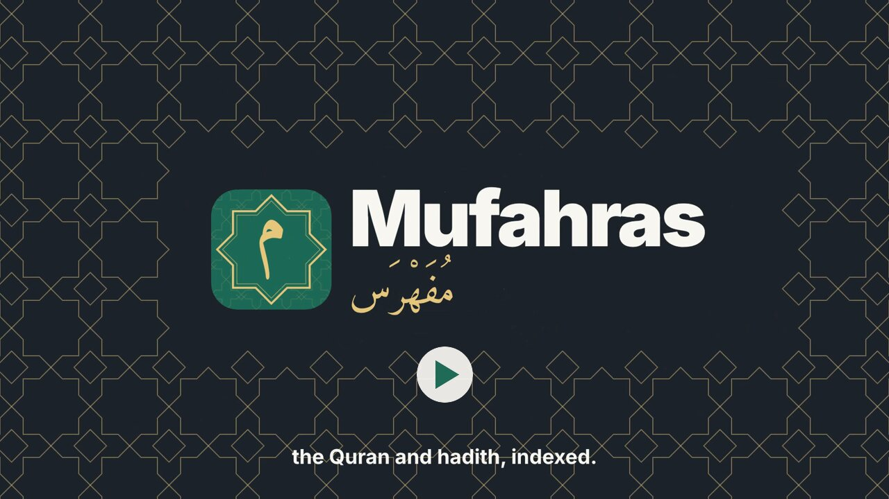
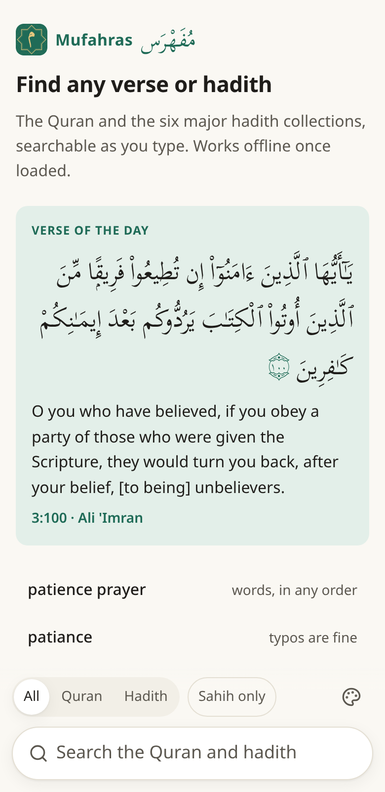
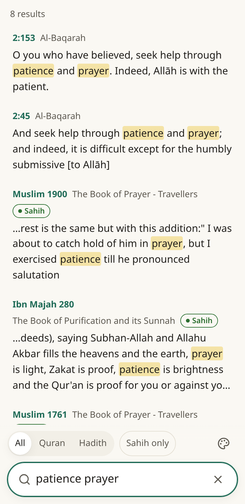
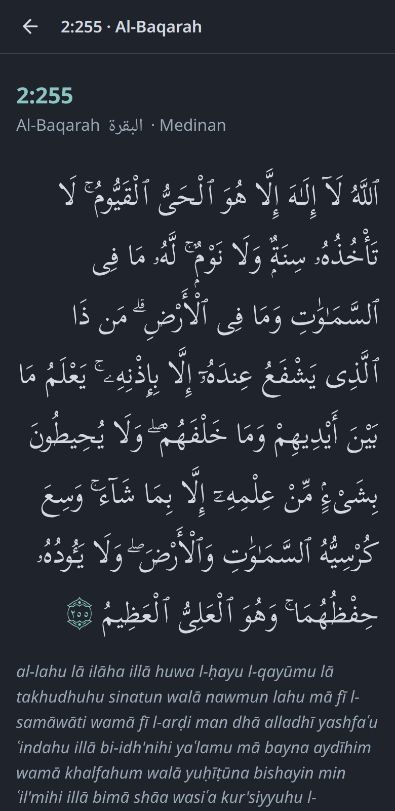
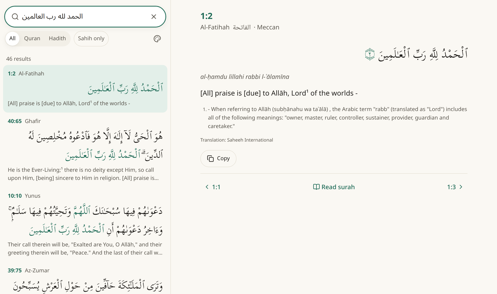

<div align="center">


# Mufahras · مُفَهْرَس

**Find any verse of the Quran, or any hadith of the six major collections, as you type.**

[**Open Mufahras →**](https://omeiirr.github.io/mufahras/)

</div>

---

*Assalamu alaikum wa rahmatullah.*

Have you ever remembered a few words of a verse, or half of a hadith someone quoted, and wanted to find where it
comes from? Mufahras is for that moment. Type what you remember, misspelled or out of order, in English, Arabic or
transliteration, and the source appears before you've finished typing. Or describe what you're looking for:
with [**Search by meaning**](#search-by-meaning) switched on, "dealing with anxiety" finds *with hardship will be
ease* (94:6), though it never uses the word.

It's free, it has no accounts and no ads, and once it's loaded it works without an internet connection.

<p align="center">
  <a href="docs/video/mufahras-showcase.mp4"></a>
  <br />
  <sub>Watch the 45-second showcase (with sound)</sub>
</p>

<p align="center">
  
  
  
</p>

## Why "Mufahras"?

*Mufahras* (مُفَهْرَس) means **indexed**. For generations, the way to find a verse from a word you remembered was
*al-Muʿjam al-Mufahras li-Alfāẓ al-Qurʾān al-Karīm*, the concordance compiled by Muḥammad Fuʾād ʿAbd al-Bāqī, which
lists every word of the Quran with the verses it appears in. Its sister work, *al-Muʿjam al-Mufahras li-Alfāẓ
al-Ḥadīth al-Nabawī*, did the same for hadith.

This app tries to carry that tradition into your pocket: an index of the Quran and the Sunnah that answers as you type.

The icon is the letter *mīm*, the first letter of the name, in gold inside an eight-pointed star, a shape found
across Islamic art and in the ۞ that marks the divisions of the mushaf.

## What you can search

- **The Quran:** the Uthmani Arabic text, the Saheeh International translation with its footnotes, and transliteration
- **Hadith:** Sahih al-Bukhari, Sahih Muslim, Sunan Abi Dawud, Jamiʿ at-Tirmidhi, Sunan an-Nasaʾi and Sunan Ibn Majah,
  in English and Arabic, with each scholar's grading shown beside the hadith

Some things to try:

| Type | To find |
|---|---|
| `patience prayer` | verses and hadith with both words, in any order |
| `patiance` | typos are fine |
| `ptnc pryr` | abbreviations work too, like fzf |
| `2:255` · `baqarah 255` · `surah yaseen` | a verse or surah directly |
| `ayatul kursi` · `amana rasul` · `hadith jibril` | well-known names for verses, surahs and hadith |
| `bukhari 1` · `tirmidhi 2516` | a hadith by its number |
| `qul huwa allahu ahad` | transliteration |
| `الحمد لله رب العالمين` | Arabic, with or without diacritics |
| `fasting` · `orphans` | topics in the Quran and chapters of the hadith books |
| a sentence you remember, in any translation | the source, even when the wording differs ("close matches") |
| `dealing with anxiety` · `visiting the sick` | with **Search by meaning** on: texts that say it in other words |

## Search by meaning

Words only go so far: the verse you're thinking of may not use the word you remember. Switch on **Search by
meaning** in the ☰ menu (it's in beta, and English only) and Mufahras also shows the verses and hadith closest
in *meaning* to what you typed, under "By meaning": "dealing with anxiety" finds *with hardship will be ease*
(94:6) and the Prophet's ﷺ dua against worry and grief; "Allah is near and answers when I call" finds 2:186;
"visiting the sick" finds the hadith of the fruit garden of Paradise (Muslim 6551).

It runs entirely on your device, with a small language model (snowflake-arctic-embed-s) that turns your words
into numbers and compares them with every verse, read together with its explanation, and every hadith. It's a
one-time download of about 40 MB (64 MB once unpacked on the device), from this app's own site, and then it
works offline too. It only finds and
shows the texts themselves; it never writes or summarizes anything. You can remove the download from the menu.

## What else is inside

**Reading.** Every verse opens with its neighbours and a link to read the whole surah. Below it: the theme of its
passage, an explanation (Al-Mukhtasar), its topics, similar verses with the shared words highlighted, and phrases
it shares with other verses (mutashabihat). **Tap any Arabic word** for its meaning and transliteration, and step
word by word through the verse. Every hadith shows its book and chapter, the Arabic, and each grading by name.

**Browsing.** All 114 surahs; the six hadith collections, chapter by chapter; every topic; the well-known
names for verses, surahs and hadith; **the 99 Names of Allah**; the **duas of the Quran**; the 15 **sajdah verses**; the phrases that
repeat across the Quran (mutashabihat); and a **graph of similar verses**, where verses that share wording are joined, and refrains like Ar-Rahman's "Which of
the favours of your Lord would you deny?" form clusters you can explore.

**Keeping.** Save verses and hadith as **bookmarks** with your own tags (export and import them, since they live
only on your device). Copy or share any text with its reference, or share it as an **image**, square or story, light
or dark. Your recent searches wait on the start screen, beside a **verse and a hadith of the day**.

**Comfort.** Four colour themes (Paper, Sepia, Dusk and Night, or Auto), text and Arabic sizes, transliteration on
or off, all in the **☰ menu**, which is reachable from every screen. And **Sakinah mode** (سكينة, tranquillity):
one switch for just search and reading, without daily cards, suggestions, extras or the graph.

On a desktop the results and the text sit side by side, with the keyboard doing the rest (`/` to search, ↑ ↓ to
move, Enter to open).

<p align="center">
  
</p>

## Fast

Everything happens on your device. The texts are indexed in the background as soon as they arrive, and each search
runs against that index in a few milliseconds on a laptop, quick enough to update on every keystroke on a phone. There's no
server to wait for, because there is no server.

The Quran (about 1 MB) is searchable within a moment of opening the app; the six hadith collections follow in the
background while you type.

## Works offline

After your first visit, Mufahras keeps the app, the Quran and the English hadith on your device, so it opens and
searches without a connection: on a flight, underground, or anywhere the signal drops. One tap on the start screen
stores the rest (mainly the Arabic of the hadith, about 6 MB; it's also in the menu), and then everything works
offline.

Install it like an app: **Add to Home Screen** in Safari on iPhone, **Install app** in Chrome on Android, or the install
icon in the address bar on desktop. On Android, an installed Mufahras appears in the **Share** menu: select a quote
in any app, share it to Mufahras, and it searches for the source.

## Private

- **No accounts, no sign-in, no tracking, no analytics, no ads, no cookies.**
- **Your searches never leave your device.** They're answered by code running on your phone or computer, not sent
  anywhere. The same goes for anything you share into the app, and for Search by meaning: its model runs on
  your device, downloaded from this app's own site, not a third party.
- **Everything stored stays on your device:** the texts kept for offline use, your settings, your bookmarks, and
  your recent searches (which you can turn off or clear from the menu).
- The app is plain files served by GitHub Pages. Like any website, GitHub sees the ordinary request for those files
  ([GitHub's privacy statement](https://docs.github.com/site-policy/privacy-policies/github-general-privacy-statement));
  nothing else is sent, and fonts and icons come from the app itself, not from third parties.

## A note on the texts

The translation and the hadith gradings come from the sources credited below and are shown as they are. A
translation conveys meaning but is not the Quran itself, and gradings are the judgements of the scholars named beside
them. For anything you act on, please confirm with people of knowledge.

If you spot a mistake in a text, a reference that points to the wrong place, or a search that should have found
something and didn't, please [open an issue](https://github.com/omeiirr/mufahras/issues). It helps everyone who uses it.

## Credits

The Quran data comes from the [Quranic Universal Library (QUL)](https://qul.tarteel.ai) by Tarteel, with the Quran
text prepared by [Tanzil](https://tanzil.net), the translation by Saheeh International, and the transliteration, word-by-word meanings,
topics and similar-verse data from QUL. The hadith collections come from [fawazahmed0/hadith-api](https://github.com/fawazahmed0/hadith-api). The 99 Names of Allah come from
[UmmahAPI](https://ummahapi.com/asma-ul-husna-api). The Quran
is set in [Scheherazade New](https://software.sil.org/scheherazade/) by SIL, the hadith Arabic in Noto Naskh Arabic,
and the logo's mīm in Amiri. Full details are in [NOTICE](NOTICE). Mufahras is not affiliated with or endorsed by
any of them; may Allah reward them for making this knowledge open.

Mufahras grew out of [quran-cli](https://github.com/omeiirr/quran-cli), a command-line version of the same idea.

## License

The code is under the [MIT License](LICENSE): use it, learn from it, build on it. The Quran and hadith data are not
covered by it; they remain under their own terms, set out in [NOTICE](NOTICE).

## For developers

It's a static web app: Svelte 5 and TypeScript, built with Vite. A build step turns the source data into compact
JSON chunks; a Web Worker indexes them and runs every search, so the page itself only draws.

```sh
npm install
npm run data:fetch   # download the hadith collections and the search-by-meaning model (pinned versions)
npm run dev          # http://localhost:5173 (add -- --host to open it from a phone)
npm test             # search ranking, search-by-meaning evaluation, data integrity and colour contrast
npm run build        # data + app into dist/
```

Every push to `main` is built, checked and deployed to GitHub Pages. [docs/TECHNICAL.md](docs/TECHNICAL.md) has
what we learned building it (normalizing Arabic, making fuzzy search fast, offline pitfalls, typesetting the
Quran), with code. [PLAN.md](PLAN.md) has the design, the data pipeline, the search engine and what's coming next, including topics, tafsir, similar verses, and finding the source
of a whole pasted quote.

---

<p align="center"><em>If it benefits you, please remember us in your duʿāʾ.</em></p>
